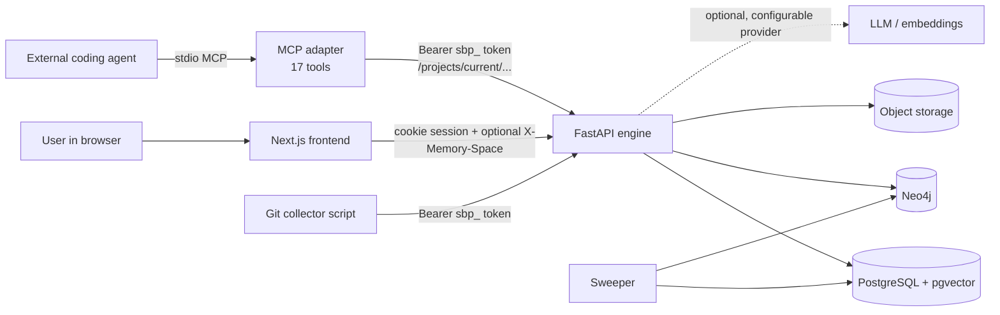
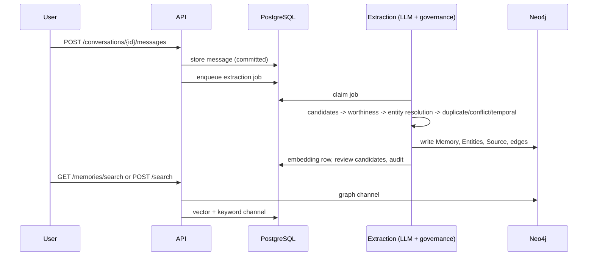
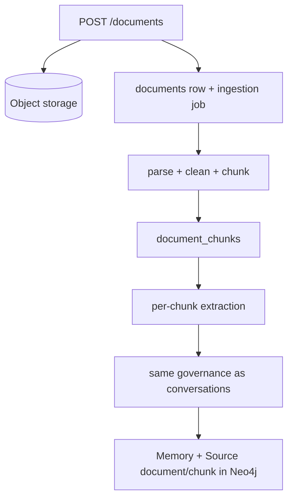
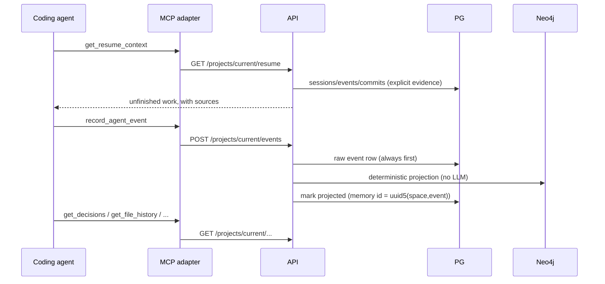
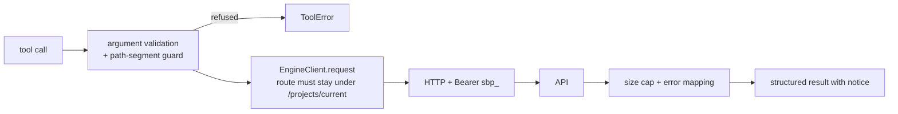
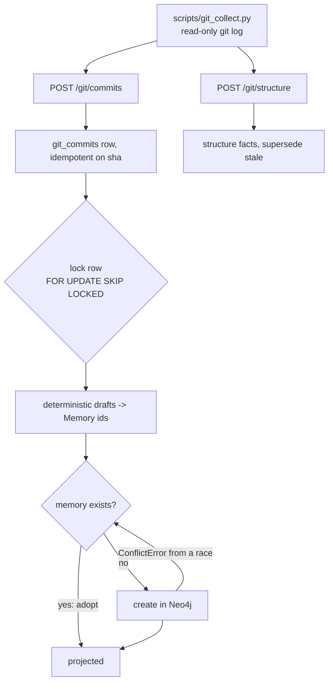
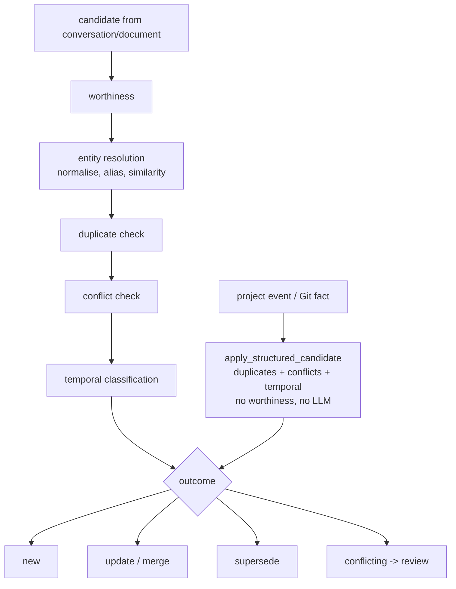
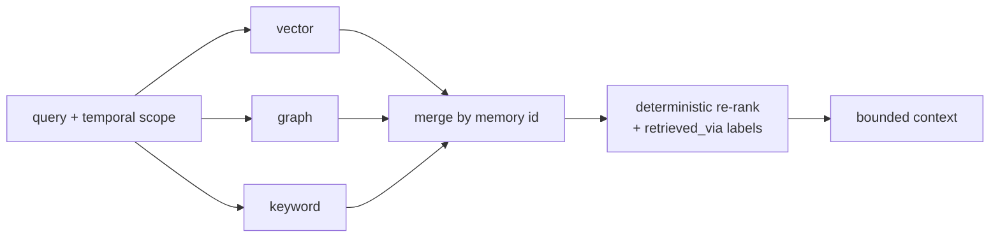
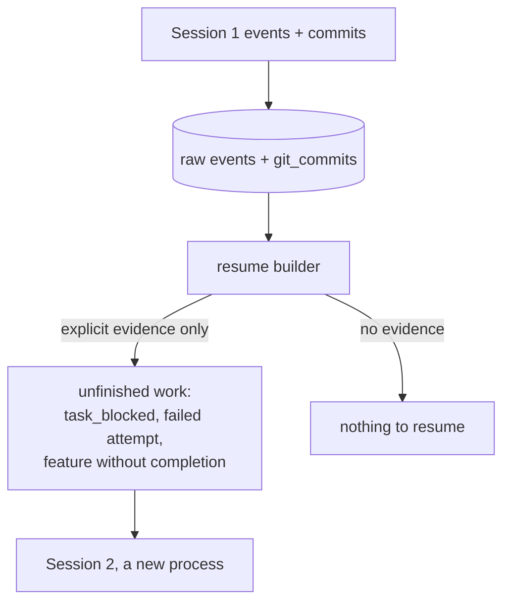
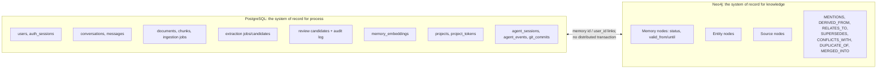

# System architecture (Phase 17, M26)

Diagrams of what is implemented. Each one matches the flow descriptions in
`SYSTEM_GUIDE.md` and the audit in `PHASE17_REPORT.md`.

## 1. High level

The engine never needs an LLM for project memory; the LLM is used for conversation/document
extraction, the internal agent and embeddings only.

## 2. Conversation flow

## 3. Document flow

## 4. Coding-agent flow (REST or MCP)

## 5. MCP flow

## 6. Git ingestion

## 7. Governance

Entity merges that are not certain go to the review queue instead of auto-merging; nothing is
deleted silently (`merged`, `superseded`, `invalid` are statuses).

## 8. Retrieval

## 9. Agent continuity

Unfinished work and failed attempts are never inferred from silence or from graph proximity.

## 10. PostgreSQL vs Neo4j

There is no distributed transaction: writes are ordered so a crash leaves a recoverable state
(raw event row first; deterministic memory ids; adopt-existing on retry). Known consistency gaps
are listed in `PHASE17_REPORT.md` §17.
